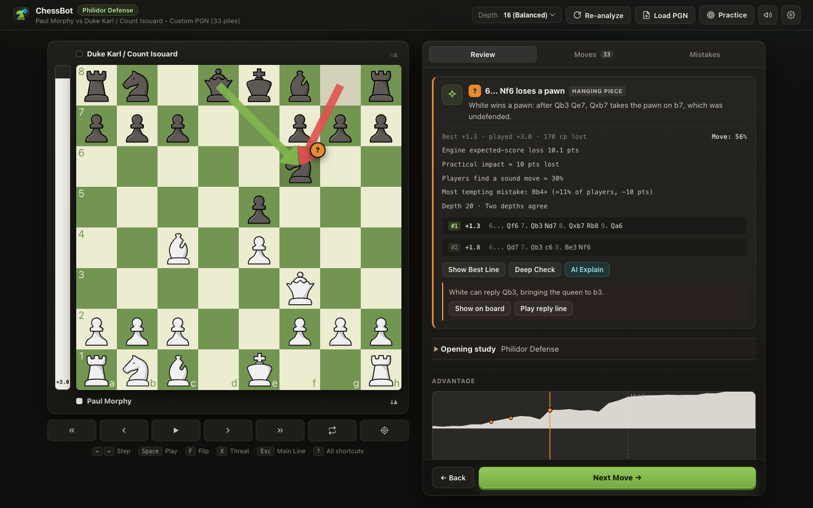
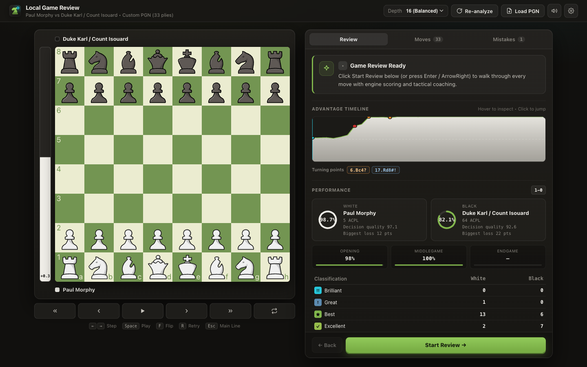
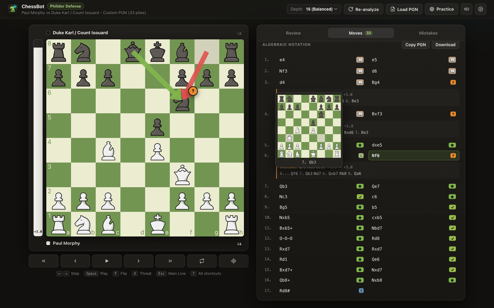
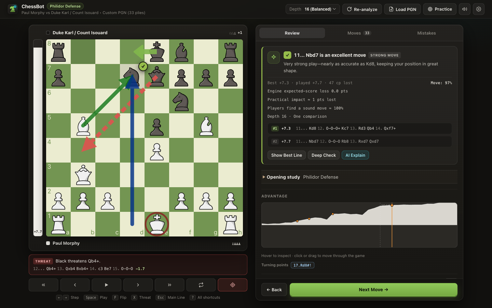
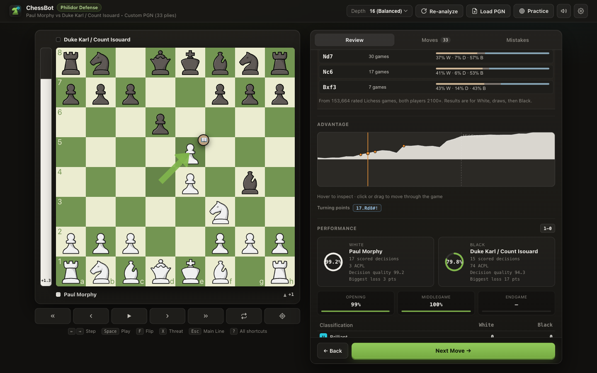
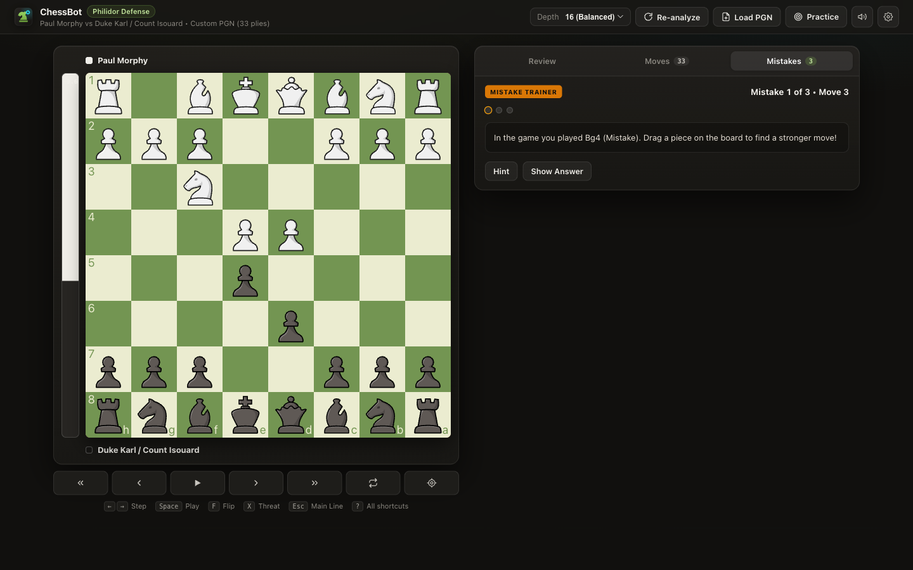
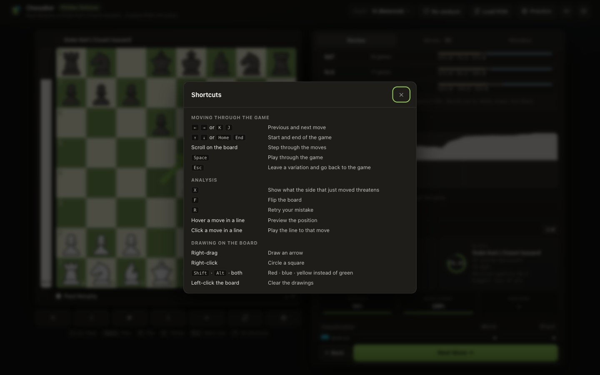

<p align="center">
  
</p>

<h1 align="center">ChessBot</h1>

<p align="center">
  <strong>Private game review for Chess.com games and PGNs, with full-strength Stockfish 19 running in your browser.</strong><br>
  Every move graded and explained. Your mistakes become practice. Nothing leaves your computer.
</p>

<p align="center">
  <a href="https://github.com/FrankieBiz/ChessBot/releases/latest"></a>
  <a href="https://github.com/FrankieBiz/ChessBot/actions/workflows/ci.yml"></a>
  <a href="LICENSE"></a>
  
  
</p>

<p align="center">
  <a href="#install">Install</a> ·
  <a href="#a-tour-of-chessbot">Tour</a> ·
  <a href="#usage">Usage</a> ·
  <a href="#accuracy-you-can-check">Accuracy</a> ·
  <a href="#privacy">Privacy</a> ·
  <a href="CHANGELOG.md">Changelog</a>
</p>

<p align="center">
  
</p>

ChessBot is a browser extension that reviews your finished games the way a coach would. Every move gets a grade, a reason, and Stockfish's best continuation. Your mistakes come back as spaced practice. The engine runs entirely on your computer, so there is no account, no upload, and no waiting in a server queue.

## Why ChessBot

| | |
| --- | --- |
| **Private** | Stockfish 19 runs in WebAssembly inside the extension. No account, analytics, or tracking. |
| **Fast** | Up to four engines work at once. A quick pass grades the whole game in well under a minute, and close calls are rechecked deeper in the background. |
| **Honest** | Grades come from the drop in expected score, are benchmarked against deeper searches, and say when they're uncertain. |
| **Explained** | Every mistake gets a reason checked on the board: the tactic it allowed or missed, the material it lost, or what the better move does. |
| **Free** | No review limits and no subscription. Released under the GPL. |

## A tour of ChessBot

### Every move, explained

Each move is graded from Brilliant to Blunder, with the engine's best lines and the reason behind the grade. The coach names the tactic only when Stockfish's line wins material or mates, so it never describes a pattern the line doesn't use. **Show on board** draws the tactic and marks the attacked pieces.

### The whole game at a glance

<p align="center">
  
</p>

- **Lichess-style chart.** White's edge shades light and Black's dark from a center line. Dots mark every Inaccuracy, Mistake, Miss, and Blunder, and dashed lines mark where the middlegame and endgame begin. Hover for the move and evaluation, or click and drag to move through the game.
- **Move times.** Games with clock data add a chart of the time spent on each move, with errors colored by grade.
- **Accuracy and Decision Quality.** Game accuracy uses a Chess.com-compatible CAPS2 calibration; the Lichess-style score and Chess.com's own Game Review score appear under each ring when available. ACPL and separate opening, middlegame, and endgame scores are shown too. Each grade count jumps to the next move of that grade.

### Comments on every mistake

<p align="center">
  
</p>

The Moves tab says which move was best and how the evaluation changed, with Stockfish's line underneath, as Lichess's computer analysis does. **Hover any move in a line to preview the position, and click it to play the line on the board.**

### See what your opponent threatens

<p align="center">
  
</p>

Press <kbd>X</kbd> to see what the side that just moved would play if it could move again. Only mates, named tactics, and moves that win material count as threats. Draw your own arrows and circles with the right mouse button, in green, red, blue, or yellow with <kbd>Shift</kbd> and <kbd>Alt</kbd>.

### Study your opening

<p align="center">
  
</p>

See where your game left the book and try the common alternatives. The explorer shows game counts and results from rated Lichess games between players rated 2100 and up. The opening catalog works offline and recognizes transpositions.

### Retry your mistakes, then practice them later

<p align="center">
  
</p>

The Mistakes tab replays your Mistakes, Misses, and Blunders from the original position. Missed mates come back as drills that only accept a mate at least as fast. Every mistake you make is also saved to the **Practice** page, where it returns after 1, 3, 7, 21, and 60 days, mixed across games. A weakness report across your reviewed games shows which kinds of mistakes you make most, how many come in easy positions, and which won games slipped away, with a button to practice each one.

### More

- **Deep Check.** Run a deeper Stockfish comparison on one move and play the deeper line.
- **Human difficulty.** For each decision, ChessBot estimates how often players find a sound move and names the most tempting mistake. The model was trained on public-domain Lichess games.
- **Practical impact.** A clock-aware model estimates how much a move changed a human player's real chances, not just the engine evaluation.
- **Annotated PGN export.** Copy or download the game with evaluations, clock times, grades, and Stockfish's better lines, ready to import into Lichess, Chess.com, or ChessBase.
- **Free exploration.** Try your own moves on the board, with a full promotion picker. Repetitions and 50-move draws are recognized.
- **Optional AI explanations.** Bring your own key for OpenAI, DeepSeek, Gemini, or any OpenAI-compatible endpoint. They stay off until you set one up.
- **Fair-play safe.** The review button appears only after a Chess.com game is over. ChessBot never runs during live play.

<p align="center">
  
</p>

Everything has a shortcut. Press <kbd>?</kbd> in the review for the full list.

## Install

ChessBot isn't in the Chrome Web Store or Firefox Add-ons yet. Install it from a release:

1. Download `chessbot-chrome-vX.Y.Z.zip` or `chessbot-firefox-vX.Y.Z.zip` from the [latest release](https://github.com/FrankieBiz/ChessBot/releases/latest), then unzip it.
2. Load it into your browser:
   - **Chrome:** open `chrome://extensions`, turn on **Developer mode**, select **Load unpacked**, and choose the unzipped folder.
   - **Firefox 140 or later:** open `about:debugging#/runtime/this-firefox`, select **Load Temporary Add-on**, and choose `manifest.json` in the unzipped folder. Firefox removes temporary add-ons when it closes.

### Build from source

You need [Node.js](https://nodejs.org/) 24 or later and the `zip` command.

```bash
git clone https://github.com/FrankieBiz/ChessBot.git
cd ChessBot
npm ci
npm test
npm run build
```

The build writes unpacked extensions to `dist/chrome` and `dist/firefox`, plus a zip for each. The full Stockfish network makes each zip about 76 MB.

## Usage

- **Chess.com:** finish a game, then select **ChessBot Review** on the game page.
- **Any PGN:** select the toolbar icon, choose **Load PGN**, paste the game, pick your color, and select **Analyze Game**.
- **Depth:** choose a whole-game target from 12 to 20, with 16 as the default. Select **Deep Check** on a reviewed move to search it separately.
- **Keyboard and mouse:** <kbd>←</kbd> <kbd>→</kbd> (or <kbd>K</kbd> <kbd>J</kbd>) step through moves, and scrolling on the board does the same. <kbd>Space</kbd> plays the game, <kbd>F</kbd> flips the board, <kbd>X</kbd> shows the threat, <kbd>R</kbd> retries a mistake, and <kbd>Esc</kbd> returns to the main line. Press <kbd>?</kbd> for the full list.
- **Problems:** open **Settings** and select **Report a problem**. It opens a GitHub bug form with your version and browser filled in, and sends nothing until you submit it.
- **Practice:** select **Practice** in the review header. Puzzles from a game first come due the day after you review it. When you paste a PGN you only want to study, untick **Save my mistakes for practice**.

## Accuracy you can check

ChessBot's grading rules and models are tested against deeper searches and held-out games. Full results and reproduction commands are in [docs/benchmarks.md](docs/benchmarks.md).

| Measurement | Result |
| --- | --- |
| Grades matching a depth-22 Stockfish reference (144 decisions) | 116 exact, 142 on serious versus minor |
| Find-rate forecast error (Brier score, lower is better) on held-out Lichess games | 0.1305, down from 0.1569 in v3.3 |
| Same forecast on held-out Chess.com games | 0.1246, down from 0.1421 in v3.3 |
| Clock-aware expected-score model versus the published Lichess curve | 5.8% lower squared error |
| Game accuracy versus Chess.com public Game Review labels | 2.6 MAE held-out (24 sides); 4.4 at depth 16 on a harder 46-side check |

The grade-agreement row was measured on the 3.8.0 grade scale. The new game accuracy uses a CAPS2-compatible calibration; the Lichess-style value and Chess.com's own score are shown under each ring when available. See [docs/benchmarks.md](docs/benchmarks.md#chesscom-compatible-game-accuracy).

[How ChessBot works](docs/methodology.md) explains the grading, search, and difficulty models in detail.

## Privacy

- Analysis runs locally. ChessBot has no accounts, analytics, or tracking.
- To review a Chess.com game, the extension reads the game from Chess.com's public API.
- AI explanations are off until you set up a provider. When you request one, the position and Stockfish lines go to the provider you chose. Your API key is stored in the browser's extension storage and sent only to that provider.
- The extension asks for access to an AI provider's site the first time you request an explanation from it.
- On Chess.com, ChessBot reads your signed-in username from the page to tell which side you played. It isn't sent anywhere.
- Practice puzzles and the weakness report are stored in the browser's extension storage on your computer.

## Project structure

| Path | Contents |
| --- | --- |
| `review.html`, `review.js`, `review.css` | The review page: board, move card, summary, drills, and settings |
| `engine.js`, `analysis.js` | Stockfish worker control, move grading, and adaptive search |
| `eval-chart.js` | Geometry and clock data for the advantage and move-times charts |
| `engine-pool.js`, `review-run.js` | Several Stockfish workers at once, and the quick-then-deeper review schedule |
| `opening-book.js`, `opening-book-data.js` | Offline opening recognition and the Lichess opening catalog |
| `opening-explorer.js`, `opening-explorer-data.js` | Sampled opening results and playable example continuations |
| `coach.js`, `coach-api.js`, `tactics.js` | Built-in coaching text, optional AI explanations, and missed-mate detection |
| `motifs.js`, `coach-reasons.js` | Named tactics and the verified reason behind each mistake |
| `lines.js`, `board-shapes.js` | Steppable engine lines, the threat position and its description, and drawn arrows and circles |
| `annotated-pgn.js` | The annotated PGN export |
| `report.js` | The pre-filled bug-report link |
| `coach-evidence.js`, `performance.js` | Board evidence for coaching and game performance context |
| `drills.js`, `variation.js` | Drill checking and variation replay |
| `practice.html`, `practice.js`, `practice.css` | The Practice page: daily review, theme practice, and the weakness report |
| `deck.js`, `weakness.js`, `training-store.js` | Spaced-review schedule, weakness report, and saved practice data |
| `board-setup.js` | The board and promotion picker shared by both pages |
| `human-move-model.js`, `difficulty-model.js`, `practical-model.js` | Human difficulty and practical-impact models, with fitted data in the matching `*-data.js` files |
| `content.js`, `background.js` | The Chess.com page button and game fetching |
| `browsers/` | Manifests for Chrome and Firefox |
| `scripts/` | Build script, benchmarks, and model training |
| `research/` | Benchmark outputs and source hashes |
| `tests/` | Unit tests for the Node.js built-in test runner |

## Roadmap

- Chrome Web Store and Firefox Add-ons listings.
- Optional endgame tablebases for perfect play with seven or fewer pieces.
- A deep-review setting that trades time for more grades matching a deeper search.

## Contributing

Contributions are welcome. Read [CONTRIBUTING.md](CONTRIBUTING.md) for setup, testing, and the evidence expected for engine or model changes. Report security issues privately as described in [SECURITY.md](SECURITY.md). Everyone taking part is expected to follow the [Code of Conduct](CODE_OF_CONDUCT.md).

## License

ChessBot is free software, released under the [GNU General Public License v3.0](LICENSE) or later.

It bundles these projects:

- [Stockfish](https://stockfishchess.org/) through [Stockfish.js](https://github.com/nmrugg/stockfish.js), GPL-3.0
- [chess.js](https://github.com/jhlywa/chess.js), BSD-2-Clause
- [cm-chessboard](https://github.com/shaack/cm-chessboard), MIT

The human-difficulty and calibration models were trained on the [Lichess open database](https://database.lichess.org/), released under CC0. The opening book combines named lines from the [Lichess chess-openings project](https://github.com/lichess-org/chess-openings) with frequent continuations from the CC0 game archives. The benchmark documentation lists the pinned inputs and the [command to regenerate the book](docs/benchmarks.md#opening-book-coverage).

ChessBot is an independent project. It is not affiliated with or endorsed by Chess.com or Lichess.
